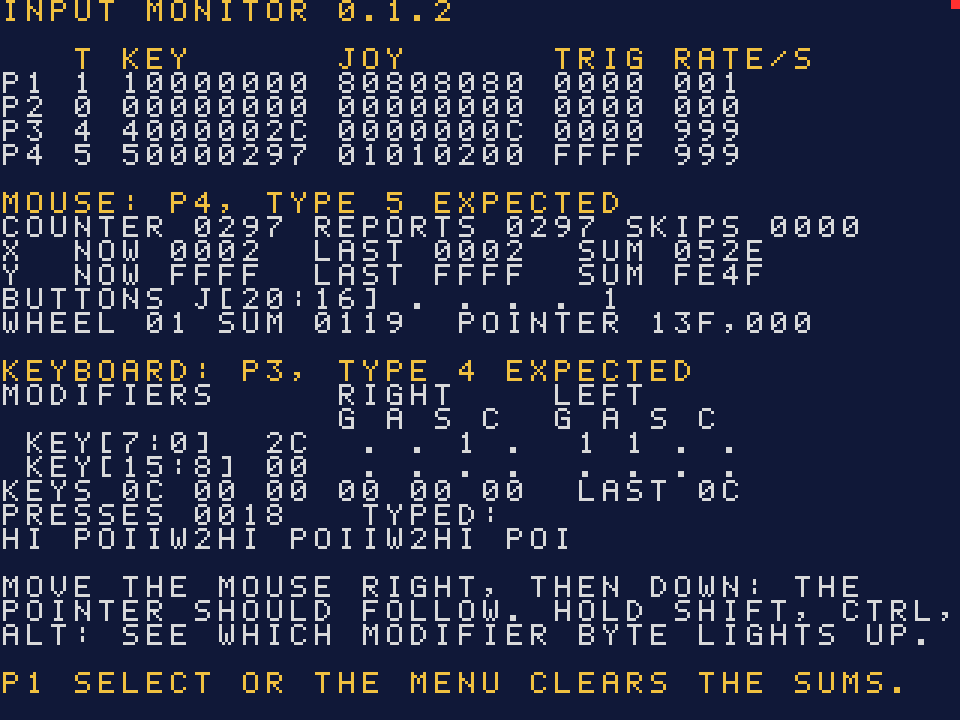

# Input Monitor for the Analogue Pocket

A test core. It puts the Pocket's four controller words on screen, raw, and
decodes the Dock's USB keyboard and mouse the way other cores read them, so
the formats can be checked on real hardware.

It was written to settle open questions for the FujiNet Pocket cart's network
cores (fujinet-hardware-analogue-pocket, `docs/NET_CORES_SCOPING.md`):
- the mouse's sign, button order and wheel;
- where the keyboard's modifier byte sits. The Intellivision core reads it in
  `cont3_key[7:0]`, the Atari ST core's notes put it in `[15:8]`.



*(The simulation's made-up input: a pad on P1, a keyboard typing on P3 and a
mouse moving right and down with a button held on P4.)*

## Install

1. Download `InputMonitor_Pocket_<version>.zip`: open the latest successful
   run under **Actions → Build Pocket core**, then the **InputMonitor_Pocket**
   artifact.
2. Unzip it; inside is a second zip. Copy that zip's `Cores` and `Platforms`
   folders to the root of the Pocket's SD card.
3. Run it from **Openfpga → Cores → Input Monitor**. Nothing has to be loaded.

## The screen

| Rows | What |
|---|---|
| **P1-P4** | Each controller's type (`key[31:28]`), raw `key`, `joy` and `trig` words in hex, and how many times per second the controller's words change (`RATE/S`, decimal, up to 999). |
| **MOUSE** | Player 4, type 5, as found on a Dock (0.1.1, a Microsoft Classic IntelliMouse): `key[15:0]` a report counter; X in `joy[15:0]` and Y in `trig[15:0]`, each a signed 16-bit count with its **low byte in bits [15:8]** (so the raw word 0100 is +1 and FBFF is -5; `NOW` shows them swapped into order); five buttons in `joy[20:16]` (bit 16 left, 17 right, 18 middle, 19 back, 20 forward). There is no separate wheel: each wheel click arrives as a one-count X report (raw 0100 or FFFF), the same as a one-count move sideways (0.1.3). The `WHEEL` line shows `joy[31:24]`, which stayed 0. On each change of the counter, half a poll later, the core takes X and Y as one report's motion, adds them to `SUM` (hex, 16-bit; negative values wrap, e.g. FFFE = -2) and moves the red pointer. `LAST` is the last non-zero X and Y. `SKIPS` counts counter jumps of more than 1. |
| **P4 LAST 8 REPORTS** | The raw `joy` and `trig` words of player 4's last eight reports, newest first (0.1.3): a change that lasts one report, like a wheel click, stays on screen to be photographed. |
| **KEYBOARD** | Read as player 3, type 4: the six HID usage codes in `joy` (bytes 0-3) and `trig` (bytes 0-1). Both candidate modifier bytes are shown bit by bit, under the HID modifier layout (bit 7 to 0: right GUI, Alt, Shift, Ctrl, then left GUI, Alt, Shift, Ctrl). Each newly pressed key counts in `PRESSES`, shows in `LAST`, and is echoed under `TYPED` (Enter clears the line, Backspace deletes). |

**Select** on player 1, or **Clear the sums** in the core's menu, clears the
sums, the pointer, the counts and the typed line.

## The tests

With the Pocket in the Dock, a USB keyboard and a USB mouse plugged in, and
the core running. A photo of the screen after each step is the easiest way to
report back.

**Mouse**
1. **Type:** P4's `T` shows 5, and `KEY` changes when the mouse moves.
2. **Counter:** watch `COUNTER` and `REPORTS` while moving the mouse. If they
   count up together and `SKIPS` stays at or near 0, `key[15:0]` is the report
   counter.
3. **Deltas or totals:** move the mouse slowly right, then stop.
   - If `X RAW` goes back to 0 when you stop, it holds per-report deltas.
   - If it keeps its value, it is a running total.
4. **Direction:** clear the sums, move right only: `SUM X` should count up
   (positive), and the pointer should go right. Then move down only: does
   `SUM Y` count up (down = positive, the usual HID convention) and does the
   pointer go down?
5. **Buttons:** press left, right, middle, back and forward in turn: note
   which of the five `BUTTONS` bits lights for each.
6. **Wheel:** clear, keep the mouse still, scroll one click up and
   photograph the report history; then one click down, and photograph it
   again. (0.1.2: each click moved X's sum by 1, not `WHEEL`.)
7. **Rate:** move the mouse continuously and read P4's `RATE/S` (the report
   rate as the core sees it; the pad poll runs at about 1,130 per second).

**Keyboard**
1. **Type:** P3's `T` shows 4.
2. **Modifiers:** hold each of left Shift, left Ctrl, left Alt, right Shift and
   right Alt alone. Note which row lights up (`KEY[7:0]` or `KEY[15:8]`), and
   which bit.
3. **Counter:** with no key held, does `KEY[15:0]` (or part of it) still
   change? A changing low byte while nothing is pressed would mean the
   modifier byte is not there.
4. **Keys:** type a word: it appears under `TYPED`. Hold several keys at once
   and watch the six `KEYS` slots fill.

**Mice tried so far:**

| Mouse | Result |
|---|---|
| Microsoft Classic IntelliMouse | Works: motion, five buttons; wheel clicks arrive as one-count X motion (0.1.1-0.1.3). |
| Microsoft Comfort Mouse 4500 | Reports and buttons only, no motion: the Dock doesn't read its motion. |

**Without the Dock:** P1 is the Pocket's own controls; the others show 0.

## Build

The GitHub Actions workflow builds every push in the `raetro/quartus:21.1`
image:
1. `tools/gen_pll.sh` generates the PLL;
2. Quartus compiles the core;
3. `tools/package.sh` assembles the SD card zip.

To do the same locally:

```sh
docker run --rm -v "$PWD:/build" -w /build raetro/quartus:21.1 tools/gen_pll.sh
docker run --rm -v "$PWD:/build" -w /build/src/fpga raetro/quartus:21.1 quartus_sh --flow compile ap_core
tools/package.sh
```

**Simulation:** `sim/run.sh` (Verilator 5 and Python's PIL) runs 1.2 s of
made-up input and writes `sim/work/frame.png`.

**Screen:** `tools/gen_screen.py` holds the layout and the font, and writes
`src/fpga/core/screen_rom.svh` and `font_rom.svh`; run it after changing the
layout.

## Files

| Path | What |
|---|---|
| `src/fpga/core/im_top.sv` | The monitor: decoding, counts, the snapshot and the video. |
| `src/fpga/core/core_top.v` | The APF top level: tie-offs, the PLL, the bridge. |
| `src/fpga/core/screen_rom.svh`, `font_rom.svh` | Generated by `tools/gen_screen.py`. |
| `src/fpga/apf/`, `core/core_bridge_cmd.v` | Analogue's framework, unchanged (as in openFPGA-7800). |
| `dist/` | The core's JSON files and platform. |
| `sim/` | The Verilator testbench. |

## License

MIT for this project's own files (`LICENSE`); Analogue's framework files are
under the APF Software License in their headers.
